# GateKeeper — ER diagram

```mermaid
erDiagram
    users ||--o{ unit_residents : "lives in"
    units ||--o{ unit_residents : "has residents"
    buildings ||--o{ units : contains
    units ||--o{ guest_passes : "passes for"
    users ||--o{ guest_passes : "creates (resident)"
    users |o--o{ guest_passes : "revokes"
    guest_passes |o--o{ access_logs : "scanned as"
    units |o--o{ access_logs : "visited"
    users ||--o{ access_logs : "scans (guard)"

    users {
        uuid id PK
        text email UK
        text password_hash "bcrypt"
        text full_name
        text phone "nullable"
        Role role "admin | resident | guard"
        timestamptz created_at
        timestamptz updated_at
    }

    buildings {
        uuid id PK
        text name UK
        timestamptz created_at
    }

    units {
        uuid id PK
        uuid building_id FK
        text number "unique per building"
        int floor "nullable"
        timestamptz created_at
    }

    unit_residents {
        uuid user_id PK, FK
        uuid unit_id PK, FK
        timestamptz assigned_at
    }

    guest_passes {
        uuid id PK
        uuid unit_id FK
        uuid created_by_id FK
        text guest_name
        PassType type "one_time | recurring"
        text token UK "random, inside the QR"
        timestamptz valid_from
        timestamptz valid_until
        int_array days_of_week "recurring: 0=Sun..6=Sat"
        int daily_start_min "recurring: Cairo time"
        int daily_end_min "recurring: Cairo time"
        timestamptz used_at "one-time: set on entry"
        timestamptz revoked_at "nullable"
        uuid revoked_by_id FK "nullable"
        timestamptz created_at
        timestamptz updated_at
    }

    access_logs {
        uuid id PK
        uuid pass_id FK "null if token unknown"
        uuid unit_id FK "copied from pass"
        uuid guard_id FK
        ScanResult result "allowed | denied"
        DenyReason reason "null when allowed"
        text guest_name "snapshot"
        timestamptz scanned_at
    }
```

## Reading the diagram

| Symbol | Meaning |
| --- | --- |
| `\|\|--o{` | one → zero or many (e.g. one building has many units) |
| `\|o--o{` | zero-or-one → many (the parent is optional, e.g. a log may have no pass) |
| PK / FK / UK | primary key / foreign key / unique |

## Pass status (derived, not stored)

| Status | Rule |
| --- | --- |
| revoked | `revoked_at IS NOT NULL` |
| used | `type = one_time AND used_at IS NOT NULL` |
| expired | `now() > valid_until` |
| active | none of the above |
